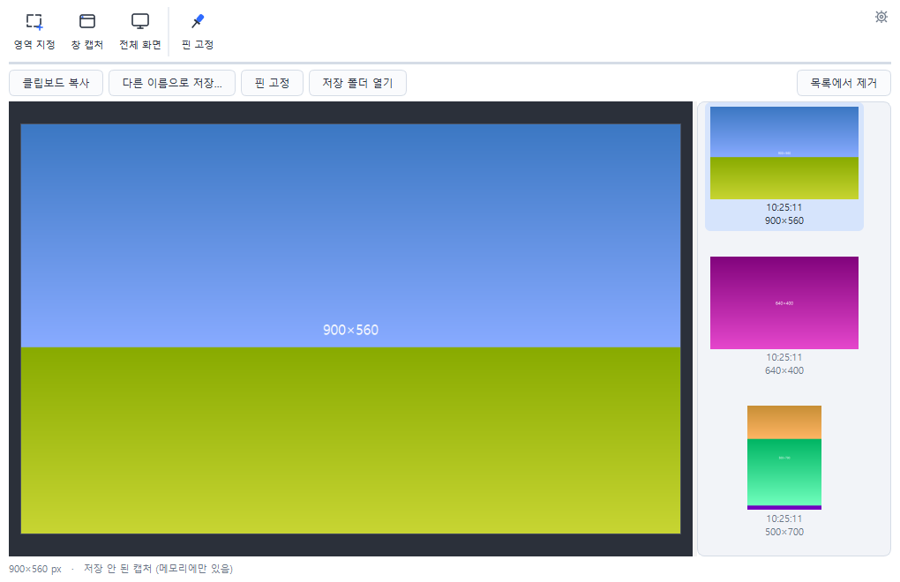
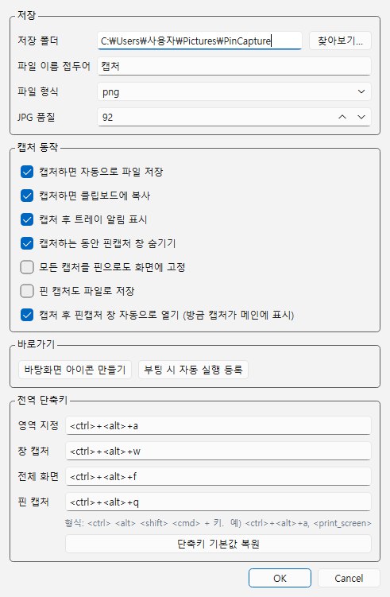
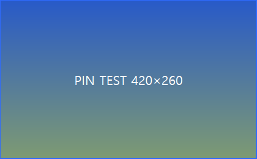

# 핀캡처 (PinCapture)

단축키 한 번으로 화면을 캡처해 바로 저장·복사하고, 필요한 부분은 화면 위에 핀으로 띄워 두는 Windows 트레이 앱입니다.



- 현재 버전: **0.6.1** (`pincapture.py`의 `APP_VERSION`)
- 대상: Windows 10 / 11, 64비트(x64)
- 인터넷 연결 없음, 계정·광고 없음

## 주요 기능

| 기능 | 기본 단축키 | 설명 |
|---|---|---|
| 영역 지정 | `Ctrl+Alt+A` | 화면을 멈춘 뒤 드래그로 선택합니다. 크기를 실제 픽셀로 보여 주고, `Esc`나 우클릭으로 취소합니다. |
| 창 캡처 | `Ctrl+Alt+W` | 지금 쓰는 창을 찍습니다. 다른 창에 일부 가려져 있어도 창 내용 전체가 찍힙니다(`PrintWindow`). |
| 전체 화면 | `Ctrl+Alt+F` | 마우스가 있는 모니터 전체를 찍습니다. |
| 핀 고정 | `Ctrl+Alt+Q` | 영역을 고르면 그 부분이 항상 위에 떠 있는 창으로 고정됩니다. |

- **자동 저장 + 클립보드**: 캡처하면 `캡처_YYYYMMDD_HHMMSS.png`(또는 `.jpg`)로 저장되고 클립보드에도 복사됩니다. 핀 캡처는 기본적으로 클립보드에만 복사됩니다.
- **보관함**: 방금 캡처는 크게 보여 주고, 이전 캡처는 오른쪽 목록에 쌓입니다. 저장 폴더에 있던 기존 캡처도 불러옵니다. `Ctrl`/`Shift`+클릭, 드래그, `Ctrl+A`로 여러 개를 골라 한 번에 복사·저장·핀 고정·목록에서 제거할 수 있습니다(파일은 지우지 않음).
- **핀**: 드래그로 이동, 마우스 휠로 크기 조절, 우클릭 메뉴(복사·저장·원래 크기), 더블클릭이나 `Esc`로 닫기.
- **트레이 상주**: 창을 닫아도 트레이에 남아 단축키가 계속 동작합니다. 중복 실행하면 새로 뜨지 않고 기존 창이 앞으로 옵니다.
- **고해상도(DPI 125%·150%) 화면**: 물리 픽셀 기준으로 캡처합니다.
- **캡처 차단 감지 (0.6.1)**: 보안 프로그램이 화면 캡처를 막아 모든 모니터가 완전히 검게 찍히면, 검은 이미지를 저장하지 않고 원인과 해결 방법을 안내합니다. 차단을 우회하지는 않습니다.

<table>
  <tr>
    <td></td>
    <td valign="top"><br><sub>핀 창(위)과 설정 창(왼쪽). 단축키는 설정에서 바꿀 수 있습니다.</sub></td>
  </tr>
</table>

## 설치

1. 이 저장소의 [Releases](../../releases/latest) 페이지에서 `PinCapture-Setup-<버전>.exe`를 받습니다.
2. 받은 파일을 실행합니다. **관리자 권한이 필요 없고**, 현재 사용자 폴더(`%LOCALAPPDATA%\Programs\PinCapture`)에 설치됩니다.
3. 설치 중에 바탕화면 바로가기와 "Windows 시작 시 자동 실행(트레이에서 대기)"을 고를 수 있습니다.

코드 서명이 없어서 아래 경고가 나올 수 있습니다.

| 상황 | 대처 |
|---|---|
| Edge: "일반적으로 다운로드되지 않습니다" | 다운로드 목록의 `⋯` → **유지** → **그래도 계속** |
| Chrome: 다운로드 경고 | 다운로드 목록에서 **계속** 또는 **유지** |
| 실행 시 파란 "Windows의 PC 보호" 창 (SmartScreen) | **추가 정보** → **실행** |
| Windows 11 **스마트 앱 컨트롤**이 켜진 PC | 서명 없는 프로그램을 아예 막기 때문에 현재 버전은 설치할 수 없습니다. |

받은 파일이 올라온 파일과 같은지 확인하려면 Releases에 함께 올라온 `PinCapture-Setup-<버전>.sha256.txt`의 값과 비교합니다.

```powershell
Get-FileHash .\PinCapture-Setup-0.6.1.exe -Algorithm SHA256
```

- **업데이트**: 새 설치 파일을 실행하면 됩니다. 실행 중인 핀캡처는 자동으로 닫히고 설정은 유지됩니다. 이때 화면의 핀과 파일로 저장하지 않은 캡처는 사라집니다.
- **제거**: 설정 → 앱 → 설치된 앱 → 핀캡처 → 제거. 설정·기록 폴더(`~/.pincapture`)도 지울지 묻습니다. 저장해 둔 캡처 이미지는 지우지 않습니다.

## 사용법 요약

- 단축키를 누르거나 핀캡처 창 위쪽의 **영역 지정 / 창 캡처 / 전체 화면 / 핀 고정** 버튼을 누릅니다.
- 캡처하면 핀캡처 창이 열리고 방금 캡처가 크게 보입니다(설정에서 끌 수 있음).
- 창의 `×`는 트레이로 숨기기입니다. 완전히 끄려면 트레이 아이콘 우클릭 → **종료**.
- 저장 폴더(기본: `사진\PinCapture`), 파일 형식(png/jpg), 파일 이름 앞부분, 단축키는 톱니 버튼(설정)에서 바꿉니다.
- 사진 폴더가 OneDrive로 백업되는 PC에서는 캡처도 OneDrive에 동기화됩니다. 원하지 않으면 저장 폴더를 바꿉니다.

자세한 사용법은 설치할 때 함께 들어가는 [사용법.txt](installer/docs/사용법.txt)에 있습니다(시작 메뉴의 **핀캡처 사용법**과 같은 내용).

## 개인정보

핀캡처는 네트워크에 연결하지 않습니다. 업데이트 확인, 사용 통계, 오류 보고 전송 기능이 없습니다. 단축키를 감지하려고 키보드 입력을 확인하지만, 입력 내용을 저장하거나 보내지 않습니다.

핀캡처가 직접 파일을 쓰는 곳은 아래가 전부입니다(`~`는 `C:\Users\<사용자>`).

| 위치 | 내용 | 언제 |
|---|---|---|
| 저장 폴더 (기본 `사진\PinCapture`) | 캡처 이미지 | 자동 저장이 켜져 있을 때(기본값) |
| `~/.pincapture/config.json` | 설정 | 첫 실행부터 |
| `~/.pincapture/pincapture.log` | 실행 기록: 시작 시각, 버전, 실행 파일 경로, 명령줄 인수, 오류. 512KB를 넘으면 `pincapture.log.old`로 바뀝니다. | 실행할 때마다 |
| `~/.pincapture/clipboard/` | 여러 캡처를 한 번에 복사할 때 쓰는 임시 PNG | 여러 개 복사할 때 |
| `~/.pincapture/pincapture.ico` | 바로가기 아이콘 | 소스 실행에서 바로가기를 만들 때만 |
| 시작 메뉴·바탕화면·시작 프로그램 바로가기 | `핀캡처.lnk` | 설치할 때 고른 항목, 또는 설정의 바로가기 버튼 |

앱은 레지스트리에 직접 쓰지 않습니다. 설치 프로그램이 남기는 설치·제거 정보와, 트레이 알림 설정처럼 Windows가 스스로 기록하는 정보는 예외입니다.

## 문제 해결

**1. 캡처가 통째로 검게 나오거나 "화면 캡처가 막혀 있어요" 안내가 뜸**

정부24·홈택스·은행 사이트의 전자문서 뷰어나 보안 프로그램이 '화면 캡처 방지'를 켠 상태입니다. 이 기능은 실행 중인 거의 모든 프로그램에 들어가기 때문에 Windows 캡처 도구 같은 다른 캡처 프로그램도 검게 찍힐 수 있습니다. **핀캡처를 다시 시작해도 해결되지 않습니다.**

1. 열려 있는 전자문서 보기 창(예: 정부24 '전자문서 전용 Viewer')을 닫고 다시 캡처합니다.
2. 그래도 검으면 그 사이트의 브라우저 창도 닫습니다.
3. 계속되면 PC를 다시 시작하거나, 설정 → 앱에서 그때 설치된 문서 뷰어(예: `ezPDFReader 2.0G`)를 제거합니다.

핀캡처는 이런 보호 기능을 일부러 우회하지 않습니다. 실제 사례 분석은 [검은 캡처 사건 기록 (2026-10-26)](docs/reviews/2026-10-26-black-capture.md)에 있습니다.

**2. 단축키가 안 먹음**

- 다른 프로그램(예: 카카오톡)과 조합이 겹치면 설정에서 다른 조합으로 바꿉니다. 형식은 `<ctrl>+<alt>+a`, `<print_screen>`처럼 씁니다.
- 관리자 권한으로 실행된 창이 앞에 있으면 Windows 보안 정책 때문에 단축키가 전달되지 않을 수 있습니다.
- 설정 창의 **전역 단축키** 제목 옆에 "(현재 사용 불가)"가 보이면 로그에서 `[hotkey]`로 시작하는 줄을 확인합니다.

**3. 실행이 안 되거나 바로 꺼짐: 로그 확인**

`%USERPROFILE%\.pincapture\pincapture.log`에 실행할 때마다 기록이 남습니다. 처리되지 않은 오류는 메시지 상자로도 보여 줍니다. 이슈에 로그를 붙일 때는 로그 속 경로에 들어 있는 사용자 이름을 지워 주세요.

## 소스에서 실행 / 빌드

`pincapture.py` 한 파일이 앱 전체입니다. 이 파일은 반드시 저장소 맨 위에 있어야 합니다(설치 스크립트·테스트·기존 바로가기가 이 위치를 씁니다).

| 할 일 | 명령 |
|---|---|
| 실행에 필요한 패키지 설치 | `py -3.13 -m pip install -r requirements.txt` |
| 소스로 실행 | `py -3.13 pincapture.py` (콘솔 없이: `pyw -3.13 pincapture.py`) |
| 개발·빌드용 패키지 설치 | `py -3.13 -m pip install -r requirements-dev.txt` |
| 테스트 | `py -3.13 -m pytest -q` |
| 설치 파일 빌드 | `py -3.13 installer\build.py` → `installer\output\PinCapture-Setup-<버전>.exe` |
| 앱 폴더까지만 빌드 | `py -3.13 installer\build.py --no-setup` |

- 버전은 `requirements*.txt`에 고정되어 있습니다(PySide6 6.11.2, pynput 1.8.2, PyInstaller 6.22.3).
- 설치 파일을 만들려면 [Inno Setup 6](https://jrsoftware.org/isinfo.php)이 필요합니다.
- 소스 실행과 설치판은 같은 `~/.pincapture` 설정을 쓰고, 동시에 하나만 실행됩니다. 설치판이 떠 있으면 소스 실행은 기존 창만 앞으로 가져오므로 먼저 트레이에서 종료하거나 `--quit`으로 끕니다.

명령줄 옵션:

| 옵션 | 동작 |
|---|---|
| `--region` `--window` `--full` `--pin` | 시작 직후 해당 캡처를 한 번 실행 |
| `--tray` | 창 없이 트레이로 시작 (자동 실행용) |
| `--quit` | 실행 중인 핀캡처를 종료하고 최대 10초 기다림 (설치·제거 프로그램용) |
| `--version` | 버전 출력 |
| `--selftest` | 창들을 그려 `selftest_out/`에 PNG로 저장 (개발용) |

| 경로 | 내용 |
|---|---|
| `pincapture.py` | 앱 소스 (버전·변경 이력은 맨 위) |
| `tests/` | pytest 테스트 (Qt offscreen, 실제 `~/.pincapture`는 건드리지 않음) |
| `installer/` | `build.py`, `PinCapture.spec`(PyInstaller onedir), `PinCapture.iss`(Inno Setup), 사용자 문서·라이선스 |
| `.github/workflows/build.yml` | 테스트 + 설치 파일 빌드, `vX.Y.Z` 태그면 초안(draft) 릴리스 생성 |
| `docs/` | 개발 문서, 검토·사건 기록, 스크린샷 |

자세한 개발 안내는 [docs/DEVELOPMENT.md](docs/DEVELOPMENT.md), 배포 절차는 [docs/RELEASE.md](docs/RELEASE.md)를 봅니다.

## 기여 / 운영

- 저장소를 관리·수정하는 사람과 AI 에이전트가 지켜야 할 규칙(바꾸면 안 되는 값, 빌드·배포 순서, 금지 사항)은 [AGENTS.md](AGENTS.md)에 있습니다.
- 앞으로 할 일과 아직 정하지 않은 사항은 [ROADMAP.md](ROADMAP.md), 버전별 변경 내용은 [CHANGELOG.md](CHANGELOG.md)에 있습니다.
- 변경을 올리기 전에 `py -3.13 -m pytest -q`가 통과하는지 확인해 주세요.
- 화면 UI 문구는 한국어 해요체로 맞추는 중입니다.

## 라이선스

**핀캡처 자체 코드는 All rights reserved입니다.** 누구나 개인적·상업적 목적으로 무료로 쓸 수 있지만, 코드의 재배포·수정·판매는 허락 없이 할 수 없습니다. 자세한 조건은 [LICENSE](LICENSE)를 보세요. 이 저장소의 공개는 코드 열람을 위한 것이며 오픈소스 라이선스를 부여하지 않습니다.

설치 파일에 포함된 오픈소스 구성 요소(Qt / PySide6, pynput, six, Python 런타임 등)의 고지와 라이선스 전문은 [installer/docs/THIRD_PARTY_NOTICES.txt](installer/docs/THIRD_PARTY_NOTICES.txt)와 [installer/docs/licenses/](installer/docs/licenses/)에 있습니다. PySide6와 pynput은 LGPL-3.0이며, 설치본에서 별도 파일로 들어 있어 사용자가 교체할 수 있습니다.

## 크레딧

- [Qt for Python (PySide6)](https://doc.qt.io/qtforpython-6/) — 화면 표시와 캡처 (LGPL-3.0)
- [pynput](https://github.com/moses-palmer/pynput) — 전역 단축키 (LGPL-3.0)
- [PyInstaller](https://pyinstaller.org/), [Inno Setup](https://jrsoftware.org/isinfo.php) — 설치 파일 빌드
- 코드는 Claude(claude.ai, Claude Code)와 함께 작성했습니다. 버전별 기록은 `pincapture.py` 맨 위 주석에 있습니다.
