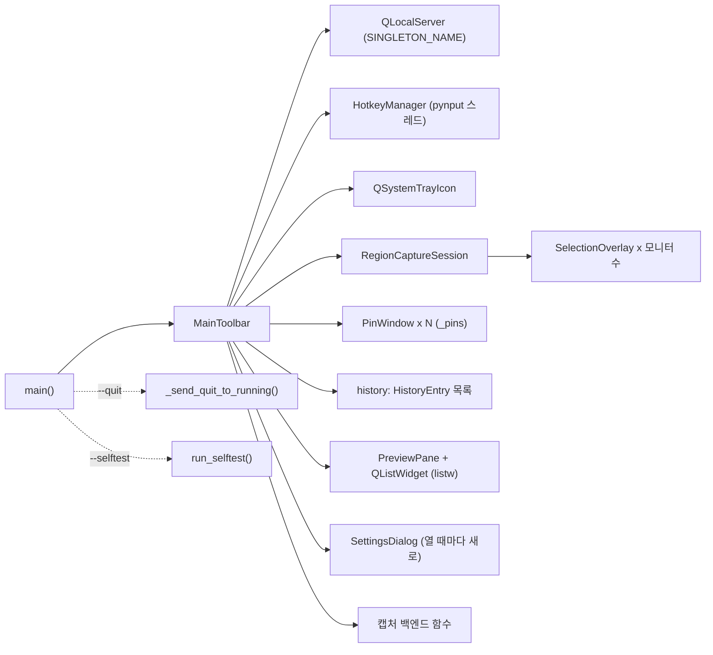
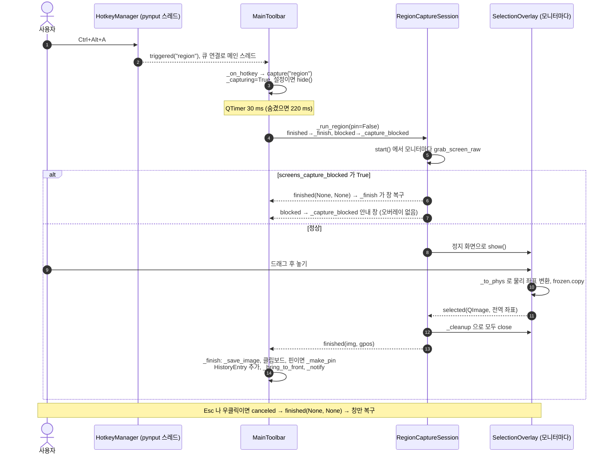
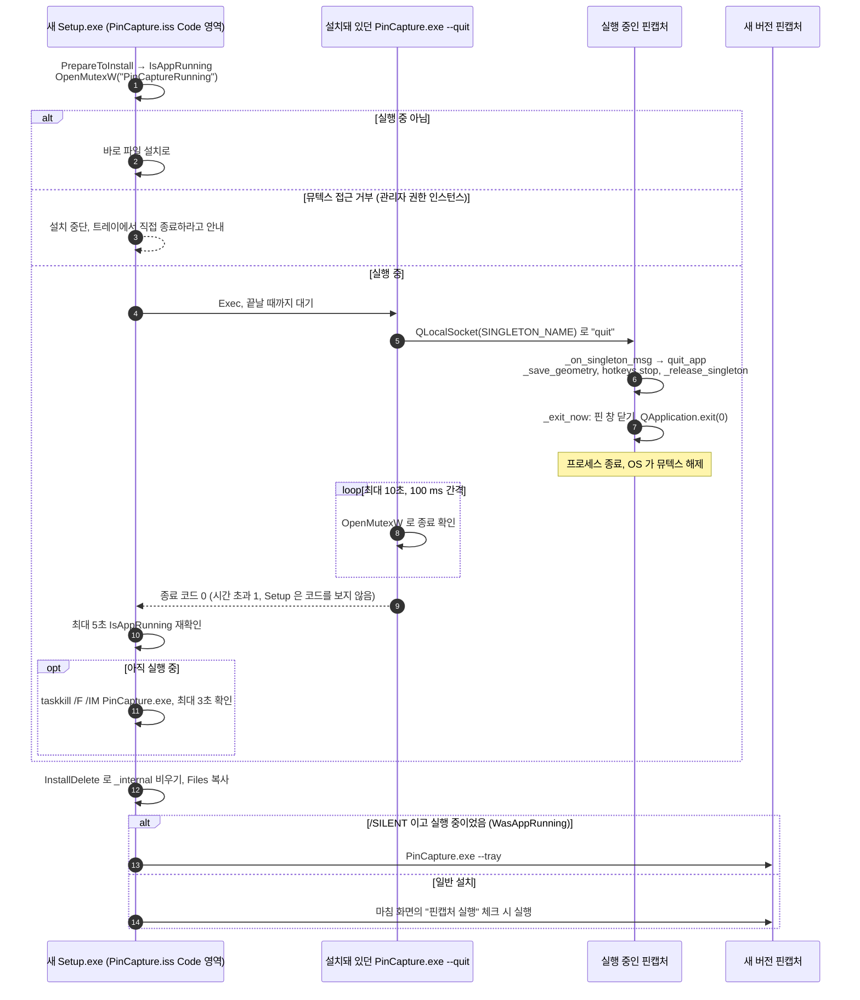

# 핀캡처 코드 구조 (ARCHITECTURE)

새 유지보수 담당자용 `pincapture.py` 지도. 앱 전체가 저장소 루트의 파일 하나(약 2,400줄)에 있다.

- 작성 기준: `APP_VERSION = "0.7.0"` (2026-10-26). 내용이 코드와 다르면 **코드가 맞다**.
- 줄 번호는 금방 바뀌므로 쓰지 않음. 함수·클래스 이름으로 찾을 것 (`Ctrl+F` / `grep -n "def 이름"`).
- 아래 절 순서 = 파일 안의 순서.
- 관련: 실행·빌드 안내 `docs/DEVELOPMENT.md` (일부 오래됨), 빌드 `installer/build.py`, 설치 스크립트 `installer/PinCapture.iss`, 시험 `tests/`.

`pincapture.py` 는 루트에서 옮기지 말 것. 소유자의 바로가기가 `D:\Tools\PinCapture\pincapture.py` 를 직접 실행하고, `installer/PinCapture.spec`·`installer/build.py`·`tests/` 가 이 경로에서 import 한다.

---

## 0. 한눈에 보기

| 구역 (파일 순서) | 주요 이름 | 하는 일 |
|---|---|---|
| 1. 부트스트랩 | `launch_argv`, `app_dir`, `_setup_logging`, `_excepthook`, `_handle_missing_deps`, `_singleton_name` | import 되는 순간 로그·예외 처리 설치, PySide6 없으면 다른 Python 으로 재실행 |
| 2. 설정 | `DEFAULTS`, `load_config`, `save_config` | `~/.pincapture/config.json` |
| 3. 아이콘 | `make_icon`, `make_app_icon` | 이미지 파일 없이 `QPainter` 로 그림 |
| 4. 캡처 백엔드 | `grab_screen_raw`, `is_pure_black`, `screens_capture_blocked`, `capture_active_window` | 화면/창 픽셀 얻기, 캡처 차단 감지 |
| 5. 영역 선택 | `SelectionOverlay`, `RegionCaptureSession` | 모니터마다 정지 화면 오버레이 |
| 6. 핀 창 | `PinWindow` | 항상 위에 뜨는 이미지 창 |
| 7. 보관함 | `HistoryEntry`, `PreviewPane` | 캡처 기록 1건, 큰 미리보기 |
| 8. 전역 단축키 | `HotkeyManager` | pynput `GlobalHotKeys` 래퍼 |
| 9. 작업 표시줄 식별 | `set_window_taskbar_identity`, `set_shortcut_app_id`, `force_foreground` | AppUserModelID·재실행 정보, 창 전경 전환 |
| 10. 바로가기 | `create_shortcut` | 바탕화면·시작 프로그램·시작 메뉴 `.lnk` |
| 11. 설정 창 | `SettingsDialog` | 설정 편집 |
| 12. 메인 창 | `ToolButton`, `MainToolbar` | UI, 트레이, 중복 실행 수신, 캡처 파이프라인, 보관함, 종료 |
| 13. 자가 점검 | `run_selftest` | `--selftest`: 창들을 PNG 로 렌더링 |
| 14. 종료 요청 | `_send_quit_to_running` | `--quit`: 실행 중인 인스턴스 종료 |
| 15. 진입점 | `main` | 인수 처리, 단일 인스턴스, 뮤텍스, 메인 창 |

실행 중 객체 관계:



---

## 1. 부트스트랩 (import 할 때 실행됨)

파일 맨 위 코드는 `import pincapture` 만으로 실행된다. 순서:

| 순서 | 이름 | 내용 |
|---|---|---|
| 1 | `IS_WINDOWS`, `APP_NAME`, `APP_VERSION`, `APP_USER_MODEL_ID`, `APP_MUTEX_NAME`, `FROZEN`, `_APP_MUTEX` | 상수. `APP_VERSION` 이 버전의 유일한 출처 (`build.py`·CI 가 정규식으로 읽음). `FROZEN` = PyInstaller EXE 로 실행 중 |
| 2 | `launch_argv(*extra)` | 자기 자신을 다시 실행하는 명령. EXE 면 `[PinCapture.exe, ...]`, 소스면 `[pythonw.exe, pincapture.py, ...]`. 바로가기·작업 표시줄 재실행·다시 시작이 모두 이걸 씀 |
| 3 | `app_dir()` | 프로그램 폴더 (바로가기 "시작 위치", 재시작 `cwd`) |
| 4 | `_CONFIG_DIR`, `LOG_PATH` | `Path.home()/.pincapture`, 그 안의 `pincapture.log` — **import 시점에 고정됨** |
| 5 | `_setup_logging()` | `PINCAP_NO_LOG` 가 없으면 stdout/stderr 를 `_Tee` 로 콘솔+로그에 동시 기록. 512 KB 넘으면 `.log.old` 로 회전. 첫 줄에 시각·버전·`exe`/`py`·Python·인수 |
| 6 | `sys.excepthook = _excepthook` | 처리 안 된 예외를 로그에 쓰고 `_msgbox` 로 표시 (pythonw 는 콘솔이 없으므로) |
| 7 | Qt import | 먼저 `QtCore` 만 `try` 로 import. `ImportError` 면 `_handle_missing_deps` |
| 8 | `_singleton_name()` → `SINGLETON_NAME` | 중복 실행 방지 파이프 이름 (아래 18절) |
| 9 | `ACCENT`, `BG`, `BORDER`, `TEXT`, `TEXT_SUB` … | 색 상수 (스타일시트·아이콘 공용) |

`_handle_missing_deps(err)`:
- `FROZEN` 이면: 구성 요소 손상 안내 메시지 후 종료 코드 1 (다른 Python 을 찾거나 pip 안내 하지 않음).
- 소스 실행이면: `_find_python_with_deps()` 가 `py -0p` 목록, Miniconda/Anaconda, `%LOCALAPPDATA%\Programs\Python\Python3*` 에서 `import PySide6, pynput` 되는 Python 을 찾음 (없으면 PySide6 만 되는 것). 찾으면 `PINCAP_REEXEC=1` 을 붙여 같은 인수로 재실행 (무한 재실행 방지), 콘솔 없이 실행됐으면 `pythonw.exe` 사용. 못 찾으면 `pip install` 명령을 보여 주고 종료 코드 1.

시험에 주는 영향: `CONFIG_DIR`, `LOG_PATH`, `SINGLETON_NAME` 이 import 때 정해지므로 `tests/conftest.py` 는 import **전에** `USERPROFILE`/`HOME`/`PINCAP_NO_LOG`/`QT_QPA_PLATFORM=offscreen` 을 설정하고, import 후 `sys.excepthook` 을 원래대로 되돌린다.

---

## 2. 설정

| 이름 | 내용 |
|---|---|
| `CONFIG_DIR`, `CONFIG_PATH` | `~/.pincapture/`, `~/.pincapture/config.json` |
| `_default_save_dir()` | `QStandardPaths` 사진 폴더 + `PinCapture` (없으면 홈) |
| `DEFAULTS` | 모든 설정 키와 기본값 (아래 표) |
| `load_config()` | `DEFAULTS` 깊은 복사 위에 파일 값을 덮어씀. `hotkeys` 는 키별로 병합. 모르는 키도 보존. 읽기 실패 시 기본값. `save_dir` 가 비면 `_default_save_dir()` |
| `save_config(cfg)` | UTF-8, `ensure_ascii=False`, 들여쓰기 2. 실패는 로그만 |

`DEFAULTS` 키:

| 키 | 기본값 | 쓰는 곳 |
|---|---|---|
| `save_dir` | `""` → 사진\PinCapture | `_save_image`, `_scan_existing_files`, `_open_folder` |
| `file_format` / `jpg_quality` | `"png"` / `92` | `_save_image` |
| `filename_prefix` | `"캡처"` | `_save_image` (`<접두어>_YYYYmmdd_HHMMSS[_n].<확장자>`) |
| `autosave` | `True` | `_finish` (일반 캡처) |
| `clipboard` | `True` | `_finish`, `_notify` |
| `notify` | `True` | `_notify`, `_copy_selected` |
| `hide_during_capture` | `True` | `capture` |
| `pin_after_capture` | `False` | `_finish` (모든 캡처를 핀으로도) |
| `pin_autosave` | `False` | `_finish` (핀 캡처 저장) |
| `show_viewer_after_capture` | `True` | `_finish` |
| `hotkeys` | `region`/`window`/`full`/`pin` → `<ctrl>+<alt>+a`/`w`/`f`/`q` | `HotkeyManager.restart`, `_update_tooltips` |
| `toolbar_pos` / `window_size` | `None` | `MainToolbar.__init__`, `_save_geometry` |
| `welcome_seen` | `False` | 첫 실행 빠른 안내. `prepare_config()` 가 0.6.x 파일(키 없음)은 `True` 로 저장해 안내를 다시 띄우지 않음 |

`main()` 은 시작할 때 `load_config()` 직후 `save_config()` 를 불러 파일을 만든다. 창 위치·크기는 숨길 때·종료·다시 시작 때 `_save_geometry()` 가 저장.

---

## 3. 아이콘

- `_make_pixmap(size, draw_fn, color)`: 2배 해상도 투명 pixmap 에 `_draw_*` 를 호출.
- `_draw_region`, `_draw_window`, `_draw_full`, `_draw_pin`, `_draw_gear`, `_draw_close`, `_draw_list`: 24px 기준 선화.
- `make_icon(kind, color, size)`: `kind` 문자열 → `_draw_*` 사전. 새 아이콘은 함수 하나 + 사전 항목 하나.
- `make_app_icon(size)`: 파란 둥근 사각형 + 흰 핀. 64px 좌표로 그리고 배율 조정. `installer/build.py` 가 이 함수로 16~256px `.ico` 를 만들므로 바꾸면 EXE 아이콘도 바뀜.

---

## 4. 캡처 백엔드

| 이름 | 내용 |
|---|---|
| `grab_screen_raw(screen)` | `screen.grabWindow(0)` 후 DPR 을 1 로 → 물리 픽셀 그대로의 pixmap |
| `is_pure_black(img)` | `QImage`/`QPixmap` 전체가 `#000000` 인지. RGB32 로 바꾼 뒤 검정으로 채운 이미지와 C++ 비교 (2560x1440 도 수 ms). `None`/빈 이미지는 `False` |
| `screens_capture_blocked(grabs=None)` | **모든** 모니터 캡처가 순검정이면 `True`. `grabs` 를 주면 다시 찍지 않음. 빈 목록은 `False` |
| `screen_under_cursor()` | 마우스가 있는 모니터 (없으면 주 모니터) |

순검정 판정 근거: 실제 화면은 작업 표시줄·글자·커서 때문에 모든 픽셀이 `#000000` 일 수 없다. 보안 프로그램의 "화면 캡처 방지"(예: Teruten WebCube 의 `T_Prevent64.dll` 주입)가 켜지면 GDI 캡처가 통째로 검게 나온다. 핀캡처는 **감지하고 설명만** 한다 (우회 금지, 20절).

Windows 전용 창 캡처 (`if IS_WINDOWS:` 블록, `ctypes` 로 user32/gdi32/dwmapi 호출):

| 이름 | 내용 |
|---|---|
| `_BITMAPINFOHEADER`, `_BITMAPINFO` | DIB 구조체 |
| `_foreground_hwnd(exclude)` | `GetForegroundWindow`. 그게 핀캡처 자신의 창이면 커서 아래 창(`WindowFromPoint` → `GetAncestor(GA_ROOT)`) |
| `_window_rects(hwnd)` | (보이는 프레임 `DWMWA_EXTENDED_FRAME_BOUNDS`, `GetWindowRect`) 물리 픽셀 |
| `_print_window(hwnd)` | 32bpp top-down DIB 에 `PrintWindow(PW_RENDERFULLCONTENT)` → 그림자·투명 테두리를 잘라낸 `QImage`. 가려진 창도 찍힘 |
| `capture_active_window(exclude_hwnds, fallback_hwnd)` | 대상 창 결정(없으면 `fallback_hwnd` = 직전 외부 창) → `_print_window` → 실패 시 화면 캡처에서 창 영역을 잘라냄 |

Windows 가 아니면 `capture_active_window` 는 마우스가 있는 모니터 전체를 돌려준다 (시험용).

---

## 5. 영역 선택: `SelectionOverlay` / `RegionCaptureSession`

`SelectionOverlay(screen, frozen)` — 모니터 하나를 덮는 프레임 없는 항상-위 `Tool` 창.
- `frozen` 은 그 모니터의 물리 픽셀 정지 화면, 창 자체는 논리 좌표(`screen.geometry()`).
- `_to_phys(rect)`: 위젯(논리) → `frozen`(물리) 배율 변환. 고 DPI 대응의 핵심 (`run_selftest` 가 200% 를 검사).
- `paintEvent`: 정지 화면 + 반투명 검정(알파 110) + 선택 영역만 원래 밝기 + `ACCENT` 테두리 + 물리 px 크기 라벨(`_draw_size_label`). 드래그 전에는 십자선과 안내 태그(`_draw_tag`).
- 마우스: 왼쪽 드래그로 선택, 4x4 미만이면 무시하고 다시 대기, 오른쪽 클릭·`Esc` = 취소. `enterEvent` 에서 포커스를 가져와 다중 모니터에서도 `Esc` 가 먹게 함.
- 시그널: `selected(QImage, QPoint)` — 잘라낸 이미지와 선택 영역 좌상단의 **전역 논리 좌표**(핀을 그 자리에 띄우는 데 씀), `canceled()`.

`RegionCaptureSession` — 모든 모니터에 오버레이를 띄우고 첫 결과 하나만 받는다.
- `start()`: 모니터마다 `grab_screen_raw`. `screens_capture_blocked(frozens)` 면 오버레이를 **띄우지 않고** `QTimer.singleShot(0, _emit_blocked)`.
- `_emit_blocked()`: `finished(None, None)` 먼저(캡처 상태 해제·창 복구), 그다음 `blocked()`.
- `_on_selected` / `_on_canceled`: `_done` 으로 한 번만 처리 → `_cleanup()` (시그널 막고 모두 `close`) → `finished(img, gpos)` 또는 `finished(None, None)`.
- 모니터를 가로지르는 선택은 불가 (오버레이가 모니터별).

---

## 6. 핀 창: `PinWindow`

- `PinWindow(image, dpr)`: 프레임 없는 항상-위 `Tool` 창, `WA_DeleteOnClose`. 논리 크기 = 픽셀 / `dpr` x `_scale`.
- 드래그 이동, 휠 확대/축소 (x1.1, 0.15~5.0), 더블클릭·`Esc` 닫기.
- 우클릭 메뉴(`contextMenuEvent`): 클립보드로 복사 / 다른 이름으로 저장(기본 폴더 = 홈) / 원본 크기 / 닫기.
- `closed(self)` 시그널 → `MainToolbar._pins` 에서 제거.

---

## 7. 보관함: `HistoryEntry` / `PreviewPane`

`HistoryEntry(image=None, path=None, ts=None)` — 캡처 1건.
- 메모리 이미지(`_image`) 또는 파일 경로(`path`) 중 하나 이상. 새 캡처는 저장했어도 `image` 를 함께 가짐, 저장 폴더에서 읽어 온 항목은 `path` 만.
- `full_image()`: 메모리 이미지 또는 파일을 매번 읽음.
- `thumbnail()`: 폭 `THUMB_W`(168) 썸네일을 한 번만 만들어 캐시. 파일은 `QImageReader.setScaledSize` 로 작게 읽음.
- `label()`: 오늘이면 `HH:MM:SS`, 아니면 `MM/DD HH:MM` + 크기.

`PreviewPane` — 어두운 배경에 현재 항목을 비율 유지로 표시, 원본보다 크게 늘리지 않음, 비었을 때 안내 문구.

---

## 8. 전역 단축키: `HotkeyManager`

- `restart(hotkeys)`: `stop()` → `from pynput import keyboard` (실패하면 `available=False`, `error` 기록, 앱은 계속 동작) → 각 조합을 `keyboard.HotKey.parse` 로 검사, 잘못된 것은 건너뜀 → `keyboard.GlobalHotKeys(mapping)` 데몬 스레드 시작.
- 콜백은 **pynput 스레드**에서 `triggered.emit(mode)` 만 한다. 수신자(`MainToolbar._on_hotkey`)가 메인 스레드 객체라 Qt 가 큐 연결로 메인 스레드에서 실행.
- `mapping` 은 조합 문자열이 키라서 두 모드에 같은 조합을 넣으면 마지막 것만 남음.
- 속성 `available`, `error` 는 설정 창 제목과 `--selftest` 출력이 씀.
- pynput 은 프로그램이 주입한 키 입력을 무시하므로 단축키 자동 시험은 불가.

---

## 9. 작업 표시줄 식별 (Windows)과 `force_foreground`

목적: 작업 표시줄에 고정했을 때 `pythonw.exe`(파이썬 아이콘) 대신 핀캡처가 고정되게 하기.

| 이름 | 내용 |
|---|---|
| `app_icon_path()` | EXE 면 EXE 자신, 소스면 `~/.pincapture/pincapture.ico` (없을 때만 `make_app_icon` 으로 생성) |
| `relaunch_command()` | `launch_argv()` 를 한 줄 명령으로 |
| `_GUID`, `_PROPERTYKEY`, `_PROPVARIANT`, `_IID_IPropertyStore`, `_FMTID_AppUserModel`, `_PKEY` | `System.AppUserModel.*` 속성용 ctypes 정의 |
| `_special_folder(name)` | `SHGetFolderPathW` (Desktop/Startup/Programs) |
| `_com_method`, `_propstore_set(ps, props)` | `IPropertyStore` vtable 직접 호출 (2 Release, 6 SetValue, 7 Commit), `VT_LPWSTR` 값 기록 |
| `set_shortcut_app_id(lnk)` | `.lnk` 에 `System.AppUserModel.ID` |
| `set_window_taskbar_identity(hwnd)` | 메인 창에 ID + `RelaunchCommand` + `RelaunchDisplayNameResource` + `RelaunchIconResource`. `main()` 이 **창을 보이기 전에** 호출 |

프로세스 자체의 ID 는 `main()` 이 `SetCurrentProcessExplicitAppUserModelID(APP_USER_MODEL_ID)` 로 설정. 설치 프로그램 바로가기의 `AppUserModelID` 와 같아야 한다.

`force_foreground(hwnd)` — Windows 의 전경 잠금을 단계적으로 우회:
1. `SetForegroundWindow`
2. 전경 창 입력 스레드에 `AttachThreadInput` 후 전환
3. Alt 키 누른 상태에서 전환
4. 그래도 안 되면 TOPMOST 켰다 끄기 (맨 앞에만 두고 로그 기록)

Qt 플랫폼이 `windows` 가 아니면(offscreen 등) 바로 `False` — `winId()` 가 실제 HWND 가 아니기 때문. Windows 가 아니면 세 함수 모두 `False` 를 돌려주는 대체 구현.

---

## 10. 바로가기: `create_shortcut(where)`

- `where`: `Desktop` | `Startup` | `Programs`. 이름은 항상 `핀캡처.lnk` (설치 프로그램과 같은 이름 → 제거 시 `[UninstallDelete]` 가 함께 지움).
- PowerShell `WScript.Shell` 스크립트를 UTF-16LE base64 `-EncodedCommand` 로 실행 (경로의 따옴표·한글 안전).
- 대상·인수는 `launch_argv()`, 시작 위치는 `app_dir()`. `Startup` 은 `--tray` 를 붙임.
- `Desktop`/`Startup` 을 만들 때 `Programs`(시작 메뉴)도 함께 갱신 — Windows 가 작업 표시줄 고정 때 AppID 가 같은 시작 메뉴 바로가기를 찾기 때문.
- 만든 뒤 `set_shortcut_app_id`. 결과는 `(성공 여부, 메시지)`.

---

## 11. 설정 창: `SettingsDialog` / 안내·정보

- `WelcomeDialog(cfg)`: 단축키(`hotkey_label` 로 `Ctrl+Alt+A` 처럼 표시)와 핀 사용법. 후원 버튼은 없다.
- `AboutDialog`: 버전, `APP_PUBLISHER` / `APP_PUBLISHER_EN`, 라이선스 요약, `third_party_notices_path()` 열기, `open_kofi()` (`KOFI_URL` = `https://ko-fi.com/chamomilegrey`).
- `prepare_config()` / `should_auto_welcome()`: 첫 실행에만 안내를 자동으로 연다. `--tray` 이고 트레이가 있으면 열지 않는다.
- `SettingsDialog(cfg, hotkey_ok, parent)`: 왼쪽 "저장"(폴더·접두어·형식·JPG 품질)과 "바로가기", 오른쪽 "캡처할 때"(체크박스 7개, 키와 1:1), 아래 "전역 단축키"(모드별 입력칸, 기본값 복원).
- `_accept()`: pynput 이 있으면 `keyboard.HotKey.parse` 로 단축키 검사 → 통과하면 **`cfg` 사전을 그 자리에서 수정**하고 `accept()`. 취소하면 `cfg` 는 그대로.
- 저장과 단축키 재등록은 호출한 쪽(`MainToolbar.open_settings`)이 한다.

---

## 12. 메인 창: `MainToolbar`

`ToolButton` 은 캡처 버튼용 `QToolButton` (아이콘 위·글자 아래, 58x56).

### 12.1 생성 (`__init__(cfg, server)`)

1. `server.newConnection` → `_on_singleton_msg` 연결 (시험·`--selftest` 는 `server=None`).
2. 소스 실행이면 `_script_mtime` 기록 (파일 갱신 감지용).
3. 상태: `_capturing`, `_was_visible`, `_pins`, `_session`, `_tray`, `_toast_shown`, `history`, `_cur_img`.
4. `_scan_existing_files()`: 저장 폴더의 최신 60개를 `path` 만 가진 `HistoryEntry` 로.
5. 창 크기 복원 → `_build_ui()` → 트레이가 있으면 `_build_tray()`.
6. `HotkeyManager` 생성·`restart(cfg["hotkeys"])` → `_update_tooltips()`.
7. Windows: 400 ms 타이머 `_track_foreground` (창 캡처용으로 직전 외부 창 `_last_ext_hwnd` 기억).
8. 위치 복원 + `_clamp_to_screen()` → `populate()`.

### 12.2 UI (`_build_ui`)

- 위: 제목과 `btn_help`(빠른 안내), `btn_about`(정보), `btn_settings`. 그 아래 캡처 버튼 줄 (`btn_region`, `btn_window`, `btn_full`, 구분선, `btn_pin`).
- 가운데: 보관함 설명과 동작 줄 (`b_copy`, `b_save`, `b_pin_sel`, `b_folder`, 오른쪽 `b_remove`).
- 아래: `QSplitter(preview, listw)`. `listw` 는 아이콘 모드 `QListWidget`, `ExtendedSelection`(Ctrl/Shift/드래그 다중 선택).
- `QShortcut` 3개 (`WidgetWithChildrenShortcut`): `Copy` → `_copy_selected`, `Delete` → `_remove_selected`, `SelectAll` → `listw.selectAll` (리스트 기본 Ctrl+C 텍스트 복사를 덮어씀).
- 맨 아래 `info` 라벨 (`_refresh_info`).
- 스타일시트는 `_build_ui`, `ToolButton`, `_header_btn` 에 직접 있음.
- `_update_tooltips()`: 캡처 버튼 툴팁에 현재 단축키 표시.

### 12.3 트레이와 창 동작

- `_build_tray()` / `_tray_menu()`: 창 열기·숨기기 / 캡처 4종 / 빠른 안내·설정·정보·후원하기 / 다시 시작 / 종료. 후원하기는 `open_kofi()` 만 호출한다. 클릭·더블클릭(`_on_tray_activated`) = `_toggle_window`. `QSystemTrayIcon.isSystemTrayAvailable()` 가 거짓이면(offscreen) `_tray` 는 `None` — 트레이를 쓰는 코드는 `None` 을 확인할 것. 메뉴 구성은 `_tray_menu()` 로 트레이 없이도 만들 수 있다.
- `closeEvent`: 트레이가 있으면 닫지 않고 숨김 + 첫 번째만 안내 알림. 없으면 `quit_app()`.
- `keyPressEvent`: `Esc` = 숨김 (트레이가 있을 때).
- `_bring_to_front(_retry=3)`: `show` → `raise_` → Windows 면 `force_foreground`, 실패 시 150 ms 뒤 재시도 → `activateWindow`.
- `_save_geometry()`: 위치·크기를 `cfg` 에 넣고 `save_config`.

### 12.4 중복 실행 수신

- `_on_singleton_msg()`: 대기 중인 연결 하나를 읽어(`waitForReadyRead(300)`) 명령 처리 — 18절 표.
- `_release_singleton()`: 서버 닫고 `QLocalServer.removeServer(SINGLETON_NAME)`. 다시 시작 전에 불러야 새 프로세스가 같은 이름으로 listen 가능.

### 12.5 캡처 파이프라인

```
_on_hotkey / 버튼 / 트레이 / --region 등
  → capture(mode)              # _capturing 이면 무시, 필요하면 hide(), 타이머
    → _run_region(pin) | _run_window() | _run_full()
      → _finish(img, gpos, pin)   # 반드시 정확히 한 번
         (차단이면 _finish(None, None) 후 _capture_blocked())
```

| 모드 | 실행 함수 | 지연 | 이미지 출처 | 차단 판정 | 핀 위치 `gpos` | 저장 여부 |
|---|---|---|---|---|---|---|
| `region` | `_run_region(pin=False)` | 30 ms, 창을 숨겼으면 220 ms | `RegionCaptureSession` | 모든 모니터 정지 화면이 순검정 | 선택 영역 좌상단 | `autosave` |
| `pin` | `_run_region(pin=True)` | 같음 | 같음 | 같음 | 같음 | `pin_autosave` |
| `window` | `_run_window()` | 최소 150 ms | `capture_active_window(_own_hwnds(), _last_ext_hwnd)` | 결과가 순검정 **이고** 모든 모니터도 순검정 (정말 검은 창은 그대로 캡처) | 없음 → 모니터 가운데 | `autosave` |
| `full` | `_run_full()` | 30/220 ms | `grab_screen_raw(screen_under_cursor())` | 이 모니터가 순검정일 때만 전체 확인 | 모니터 좌상단 | `autosave` |

`_finish(img, gpos, pin)`:
1. `_session = None`, `_capturing = False`.
2. `img` 가 없으면(취소·차단·창 못 찾음) 창만 원래대로 보이고 끝.
3. 핀 여부 `pin or pin_after_capture`, 저장 여부(위 표) → `_save_image` → `clipboard` 면 복사 → 핀이면 `_make_pin(img, gpos)`.
4. `HistoryEntry(image=img, path=path)` 를 `history` 맨 앞에 넣고 `add_entry` → `_trim_history()` (최대 150).
5. 일반 캡처이고 `show_viewer_after_capture` 면 `_bring_to_front()`, 아니면 이전 표시 상태 복구.
6. `_notify(path)` (트레이 알림). `PINCAP_TEST_AUTOEXIT` 면 `SAVED:<경로>` 출력 후 종료.

`_capture_blocked()`: 로그 기록, 트레이 경고 알림, 비모달·항상-위 `QMessageBox` (`_blocked_box`, 한 번 만들어 재사용)로 원인과 해결 순서(문서 뷰어 닫기 → 그 사이트 브라우저 창 닫기 → 재부팅·제거) 안내. "다시 시작" 버튼은 일부러 없음 — 주입기가 도는 동안 핀캡처를 다시 켜도 수 초 안에 다시 주입된다 (2026-10-26 실사례).

그 밖: `_own_hwnds()` (자기 창 HWND 집합), `_save_image(img)` (폴더 생성, 같은 이름이면 `_1`, `_2`…, JPG 는 RGB32 로 변환), `_make_pin(img, gpos)` (`gpos` 가 없으면 모니터 가운데), `_notify(path)`.

### 12.6 보관함과 다중 선택

**규칙: `history[i]` 와 `listw` 의 `i` 번째 항목은 항상 같은 캡처.** 넣고 빼는 코드는 둘을 함께 바꾼다.

| 이름 | 내용 |
|---|---|
| `_scan_existing_files()` | 저장 폴더 `*.png`/`*.jpg`/`*.jpeg` 최신 60개 |
| `_trim_history(limit=150)` | 넘치면 뒤에서부터 제거 |
| `populate()` / `add_entry(entry)` / `_make_item(e)` | 리스트 전체 다시 채우기 / 맨 앞에 하나 추가 / 썸네일 항목 생성 |
| `_select_only(row)` | 그 행만 선택하고 현재 항목으로 (다중 선택 모드에서 `setCurrentRow` 가 기존 선택을 안 지우는 문제 대응) |
| `_current_entry()` / `_selected_rows()` / `_selected_entries()` | 현재 항목 / 선택 행(없으면 현재 행) / 선택 항목 |
| `_on_row_changed(row)` / `_refresh_info()` | 미리보기 갱신 / 아래 정보 줄·제거 버튼 개수 |
| `_copy_selected()` | 1개 = 이미지, 여러 개 = 파일 URL 묶음 + 첫 장 이미지. 저장 안 된 캡처는 `~/.pincapture/clipboard/` 에 임시 PNG (매번 비우고 다시 씀) |
| `_save_selected_as()` | 1개 = 파일 대화상자, 여러 개 = 폴더 선택 후 파일 복사(메모리 캡처는 PNG) |
| `_pin_selected()` | 모두 핀, 32px 씩 계단식 배치 |
| `_open_folder()` | 저장 폴더 열기 (없으면 생성) |
| `_remove_selected()` | 목록에서만 제거, **파일은 지우지 않음** |

### 12.7 종료와 다시 시작

- `quit_app()`: `_save_geometry` → `hotkeys.stop` → `_release_singleton` → 트레이 숨김 → `_exit_now()`.
- `restart_app()`: 위와 같이 정리 → `launch_argv()` 로 새 프로세스(`cwd=app_dir()`, `PINCAP_REEXEC` 제거, EXE 면 `PYINSTALLER_RESET_ENVIRONMENT=1`) → `_exit_now()`.
- `_exit_now()`: 핀 창을 모두 닫고 `QApplication.instance().exit(0)`. `QApplication.quit()` 는 Qt 6 에서 취소 가능한 요청이라, 메인 창이 닫기를 거부(트레이로 숨김)하고 핀 창이 남아 있으면 무시되어 트레이도 단축키도 없는 유령 프로세스가 남았다 (v0.6.0 에서 수정, 회귀 시험 `tests/test_process.py::test_quit_really_exits_with_pins_on_screen`).

### 12.8 설정 열기

`open_settings()`: `SettingsDialog(self.cfg, self.hotkeys.available).exec()` → OK 면 `save_config` → `hotkeys.restart` → `_update_tooltips`. 저장 폴더를 바꿔도 보관함 목록을 다시 읽지는 않음.

---

## 13. 자가 점검: `run_selftest()`

- 현재 폴더의 `selftest_out/` 에 `main.png`, `settings.png`, `welcome.png`, `about.png`, `pin.png`, `overlay.png` 저장 (더미 캡처 3개, 더미 정지 화면).
- 오버레이 좌표 변환과 200% DPI 변환(`dpi_mapping_ok` / `dpi_mapping_FAIL`)을 출력.
- 단축키 상태(`available`, `listener_alive`, `error`), 버전, `FROZEN`, `launch_argv`, `relaunch_command`, `app_dir`, 아이콘 경로를 출력.
- 쓰는 곳: `installer/build.py` 의 빌드 후 연기 시험(EXE, offscreen), `tests/test_process.py`, `docs/images/` 스크린샷.
- 주의: 종료 코드는 렌더링이 끝나면 항상 0 (`dpi_mapping_FAIL` 이어도). `MainToolbar(cfg)` 를 실제로 만들므로 단축키를 잠깐 실제 등록하고, 홈을 격리하지 않으면 실제 설정 파일을 읽는다.
- 스크린샷 다시 만들기: offscreen 은 글꼴이 없어 글자가 안 나오므로 실제 Windows 화면에서, 격리된 홈과 중립 저장 폴더(예: `C:\Users\<사용자>\Pictures\PinCapture`)로 실행 — 설정 창 그림에 경로가 찍힌다.

---

## 14. 종료 요청: `_send_quit_to_running()`

1. `QLocalSocket` 으로 `SINGLETON_NAME` 에 연결 (1초). 실패 = 실행 중 아님 → 0.
2. `quit` 전송.
3. Windows: 100 ms 마다 `OpenMutexW(APP_MUTEX_NAME)` — 열리지 않으면 종료 확인 → 0. 10초 넘으면 1.

---

## 15. 진입점: `main()`

1. `argparse` — `--selftest --region --window --full --pin --tray --quit --version`. `parse_known_args` 라 모르는 인수(옛 바로가기의 낡은 경로 등)는 로그만 남기고 무시.
2. Windows 가 아니고 `DISPLAY` 가 없으면 `--selftest` 를 offscreen 으로.
3. Windows: `SetCurrentProcessExplicitAppUserModelID(APP_USER_MODEL_ID)`.
4. `QApplication` 생성, `setQuitOnLastWindowClosed(False)` (트레이 상주).
5. `--selftest` → `run_selftest()`, `--quit` → `_send_quit_to_running()` (여기서 끝, 설정 파일·뮤텍스 안 건드림).
6. `load_config()` → `save_config()`.
7. 단일 인스턴스 확인: `SINGLETON_NAME` 에 300 ms 안에 연결되면 `show`/`tray` 를 보내고 종료 코드 0 (`show` 전에는 `AllowSetForegroundWindow(ASFW_ANY)`).
8. 아니면 `removeServer`(비정상 종료 잔여물) → `QLocalServer` + `UserAccessOption` → `listen`.
9. Windows: `CreateMutexW(APP_MUTEX_NAME)` 를 `_APP_MUTEX` 에 보관 (프로세스가 끝나면 OS 가 해제).
10. `MainToolbar(cfg, server)` → `set_window_taskbar_identity` → `--tray` 가 아니거나 트레이가 없으면 `show()`.
11. `--region` 등 캡처 플래그가 있으면 600 ms 뒤 한 번 (첫 번째 플래그만).
12. `PINCAP_TEST_RESTART` 면 1.5초 뒤 `restart_app` → `app.exec()`.

---

## 16. 시퀀스: 영역 캡처



---

## 17. 시퀀스: 설치 프로그램 업그레이드 (`--quit`)

제거 때도 같은 `CloseRunningApp` 이 `usAppMutexCheck` 단계에서 돈다 (실패하면 제거 중단).



`--quit` 을 실행하는 것은 **설치돼 있던(이전 버전) EXE** 다. 그래서 `quit` 메시지와 뮤텍스 이름은 버전이 바뀌어도 유지해야 한다.

---

## 18. 프로세스 간 통신 (IPC)

채널:

| 채널 | 이름 | 범위 | 만드는 곳 | 쓰는 곳 |
|---|---|---|---|---|
| `QLocalServer` (Windows 명명 파이프) | `SINGLETON_NAME` = `pincapture-single-instance-<sha1(도메인\사용자\|홈 폴더) 앞 10자리>-<세션 ID>` (Windows 외: `pincapture-single-instance`) | 사용자·홈·로그온 세션별. `UserAccessOption` 으로 같은 사용자만 연결 | `main()` | 두 번째 실행(`main`, 연결 대기 300 ms), `_send_quit_to_running`(1초) |
| 이름 있는 뮤텍스 | `APP_MUTEX_NAME` = `PinCaptureRunning` | 세션 (접두어 없음 = `Local\`) | `main()` → `_APP_MUTEX`, 프로세스가 끝날 때까지 보유 | `PinCapture.iss` 의 `IsAppRunning`, `_send_quit_to_running` 의 종료 확인 |

`_singleton_name()` 은 홈 폴더도 해시에 넣는다 — 임시 홈을 쓰는 시험의 `--quit` 이 실제로 켜져 있는 핀캡처를 끄지 않게 하기 위함.

메시지 (`MainToolbar._on_singleton_msg`). 형식: ASCII 바이트 그대로, 줄바꿈·응답 없음. 받는 쪽은 `decode(errors="ignore").strip().lower()`.

| 보내는 쪽 | 바이트 | 받는 쪽 동작 |
|---|---|---|
| `main()` — 이미 실행 중일 때 일반 실행 (바로가기·시작 메뉴) | `show` | 소스 실행이고 `pincapture.py` 가 시작 때보다 0.5초 넘게 새로우면 `restart_app()` (개발용 자동 갱신), 아니면 `_bring_to_front()` |
| `main()` — 이미 실행 중일 때 `--tray` (자동 실행 중복) | `tray` | 아무것도 안 함 |
| `_send_quit_to_running()` — `--quit` (설치·제거 프로그램) | `quit` | `QTimer.singleShot(0, quit_app)` |
| 빈 연결, 그 밖의 값 | — | 무시 |

---

## 19. 환경 변수

| 변수 | 설정하는 곳 | 효과 |
|---|---|---|
| `PINCAP_NO_LOG` | `build.py`(아이콘 그리기, 연기 시험), `tests/` | `_setup_logging` 건너뜀 |
| `PINCAP_REEXEC` | `_handle_missing_deps` | 다른 Python 으로 재실행된 표시 (재실행 반복 방지). `restart_app` 이 지움 |
| `PINCAP_TEST_AUTOEXIT` | 수동 시험 | `_finish` 후 `SAVED:<경로>` 출력, 300 ms 뒤 종료 |
| `PINCAP_TEST_RESTART` | 수동 시험 | 시작 1.5초 뒤 `restart_app` |
| `PYINSTALLER_RESET_ENVIRONMENT` | `restart_app` (EXE) | 새 프로세스가 곧 정리될 부모의 PyInstaller 런타임을 물려받지 않게 |
| `QT_QPA_PLATFORM=offscreen` | `tests/`, `build.py` 연기 시험, `main`(Windows 외 `--selftest`) | 화면 없이 Qt 실행. 이때 트레이 없음(`_tray is None`), `force_foreground` 는 아무것도 안 함 |

---

## 20. 깨뜨리면 안 되는 규칙

1. `APP_USER_MODEL_ID`(`"pincapture.app"`) = `PinCapture.iss` 의 `#define AppUserModelID`, `APP_MUTEX_NAME`(`"PinCaptureRunning"`) = `#define AppMutex`. 하나만 바꾸면 작업 표시줄 고정·실행 감지가 깨짐.
2. `PinCapture.iss` 의 `AppId` GUID 는 절대 바꾸지 않음 (바꾸면 업그레이드가 아니라 별개 프로그램으로 설치됨).
3. 다시 실행·바로가기 명령은 항상 `launch_argv()` / `app_dir()` 로. EXE 에는 실제 `__file__` 이 없다.
4. 종료는 항상 `quit_app()`/`restart_app()` → `_exit_now()` → `QApplication.exit(0)`. `QApplication.quit()` 를 쓰지 않음.
5. `SINGLETON_NAME` 은 `_singleton_name()` 으로만 (사용자·홈·세션별), 서버는 `UserAccessOption`. 메시지 `show`/`tray`/`quit` 와 뮤텍스는 설치돼 있던 이전 버전 EXE 와의 약속이므로 유지.
6. 뮤텍스 핸들 `_APP_MUTEX` 는 프로세스가 끝날 때까지 닫지 않음 (`--quit` 과 설치 프로그램이 이걸로 종료를 확인).
7. 다른 회사의 화면 캡처 방지(DXGI/WGC 로 돌아가기, 후킹 해제 등)를 우회하는 코드는 넣지 않음. 감지(`is_pure_black`, `screens_capture_blocked`)와 설명(`_capture_blocked`)만.
8. 모든 캡처 경로는 `_finish(...)` 를 **정확히 한 번** 부른다. 안 부르면 `_capturing` 이 `True` 로 남아 이후 캡처가 전부 무시되고 창이 숨은 채로 남는다.
9. `RegionCaptureSession` 은 끝날 때까지 `MainToolbar._session` 이 참조를 쥔다 (안 그러면 가비지 수집).
10. `history` 와 `listw` 의 순서는 항상 일치 (12.6).
11. `HotkeyManager` 콜백(pynput 스레드)에서는 시그널만 emit. 위젯을 직접 만지지 않음.
12. `set_window_taskbar_identity` 는 메인 창을 처음 `show()` 하기 전에.
13. `APP_VERSION = "X.Y.Z"` 줄 형식 유지 (큰따옴표, `=` 양쪽 공백 한 칸). `build.py` 와 CI 태그 검사가 정규식으로 읽는다.
14. 빌드는 PyInstaller **onedir** 유지 (onefile 은 시작 6~14초, onedir 약 3초). pynput 은 `.py` 그대로(`module_collection_mode`, LGPL 교체 가능성). 안 쓰는 Qt 플러그인은 `PinCapture.spec` 의 `DROP` 에서 빼고 `build.py` 의 `MUST_HAVE`/`MUST_NOT` 가 검사 — 둘과 `THIRD_PARTY_NOTICES.txt` 를 함께 맞춘다.
15. `.iss` 와 `installer/docs/*.txt` 는 UTF-8 BOM + CRLF (Inno 는 BOM 이 있어야 한글을 읽음, `.gitattributes` 참고).
16. 새 외부 의존성은 `installer/docs/THIRD_PARTY_NOTICES.txt` 고지 + `installer/docs/licenses/` 라이선스 원문 추가.

---

## 21. "X 를 바꾸려면" 빠른 표

| 바꿀 것 | 고칠 곳 |
|---|---|
| **UI 문구** | 번역 테이블 없음 — `pincapture.py` 안의 리터럴. 위치: `_excepthook`, `_handle_missing_deps`, `SelectionOverlay.paintEvent`(안내 태그), `PinWindow`(툴팁·`contextMenuEvent`), `PreviewPane.paintEvent`, `create_shortcut`, `SettingsDialog`, `MainToolbar` 의 `_build_ui`·`_update_tooltips`·`_build_tray`·`closeEvent`·`_capture_blocked`·`_notify`·`_refresh_info`·`_copy_selected`·`_save_selected_as`. 말투는 해요체로 통일하는 중 (예전 문구는 반말). 시험이 일부 문구를 검사: `tests/test_history.py`(`"2개 선택"`, `"목록에서 제거 (2)"`, `"아직 캡처가 없어"`), `tests/test_capture_blocked.py`(`"전자문서"`, `"닫"`, 버튼에 `"다시 시작"` 없음). 버튼·메뉴 이름을 바꾸면 `installer/docs/사용법.txt` 와 `docs/images/*.png`(13절 방법으로 다시 생성)도. 설치 프로그램 문구는 `installer/PinCapture.iss` 에 따로 |
| **새 캡처 모드** | ① `MainToolbar.capture` 에 분기·지연 ② `_run_<모드>()` 작성 — 차단 확인(`is_pure_black` + `screens_capture_blocked` → `_finish(None, None, …)` 후 `_capture_blocked()`), 끝에 `_finish` 정확히 한 번 ③ 버튼: `_build_ui` 에 `ToolButton` + `make_icon` 용 `_draw_<종류>` ④ `_update_tooltips` ⑤ 트레이: `_build_tray` ⑥ 단축키: `DEFAULTS["hotkeys"]` 키 + `SettingsDialog` 의 `labels` 사전 (`HotkeyManager` 는 모드 문자열을 그대로 emit) ⑦ 명령줄: `main()` 의 `add_argument` 와 캡처 플래그 루프 ⑧ 시험 `tests/test_capture_blocked.py` 방식 ⑨ `사용법.txt` |
| **새 설정** | ① `DEFAULTS` 에 키 (기존 사용자는 `load_config` 병합으로 자동 기본값) ② `SettingsDialog.__init__` 에 위젯, `_accept` 에서 `cfg` 에 기록 ③ 쓰는 곳에서 `self.cfg["키"]` ④ 시험 픽스처가 끄거나 고정해야 하면 `tests/conftest.py` 의 `toolbar` 의 `cfg.update` ⑤ 2절 표, `사용법.txt` |
| **새 트레이 메뉴 항목** | `MainToolbar._build_tray` 에 `m.addAction(문구, 슬롯)`. 트레이가 없는 환경(`_tray is None`)에서도 같은 기능에 닿을 길이 필요하면 메인 창 버튼도 |
| **단축키 형식·파싱** | 형식은 pynput 문법(`<ctrl>+<alt>+a`). 등록·건너뛰기: `HotkeyManager.restart` (`keyboard.HotKey.parse`, `keyboard.GlobalHotKeys`). 입력 검사: `SettingsDialog._accept`. 안내 문구: `SettingsDialog.__init__` 의 placeholder·`tip`. 기본값: `DEFAULTS["hotkeys"]`. 표시: `_update_tooltips`(문자열 그대로) |
| **pynput → Win32 `RegisterHotKey` 교체** (검토 중) | `HotkeyManager` 만 교체하고 겉모양 유지: `triggered(str)`, `available`, `error`, `restart(dict)`, `stop()`, `_listener.is_alive()`(`run_selftest` 가 씀). 기존 설정 파일의 pynput 형식 문자열을 계속 읽거나 변환할 것. 함께: `requirements.txt`, `PinCapture.spec` 의 `module_collection_mode`, `build.py` `MUST_HAVE` 의 `_internal/pynput/keyboard/_win32.py`, `THIRD_PARTY_NOTICES.txt`·`licenses/`(pynput LGPL, six), `_find_python_with_deps`·`_handle_missing_deps` 의 pynput 언급 |
| **앱 버전** | `APP_VERSION` 한 곳 + 파일 맨 위 주석 이력. 태그는 `vX.Y.Z` 가 `APP_VERSION` 과 같아야 CI 통과 |
| **색·스타일** | 색 상수(`ACCENT` 등)와 `_build_ui`·`ToolButton`·`_header_btn` 의 스타일시트. 미리보기 배경·오버레이 어둡기는 `PreviewPane.paintEvent`·`SelectionOverlay.paintEvent` 에 직접 |
| **앱 아이콘** | `make_app_icon`. 소스 실행은 `~/.pincapture/pincapture.ico` 를 한 번만 만들므로 바꾼 뒤 그 파일을 지워야 바로가기·작업 표시줄에 반영. EXE 아이콘은 다시 빌드 |
| **저장 파일 이름** | `MainToolbar._save_image` (일괄 저장·임시 복사 파일 이름은 `_save_selected_as`, `_copy_selected`) |
| **보관함 개수** | 시작 시 불러오는 수: `_scan_existing_files` (60). 최대 보관: `_trim_history` (150). 썸네일 폭: `HistoryEntry.THUMB_W` |
| **캡처 차단 안내** | `MainToolbar._capture_blocked` (안내 창·트레이 알림). 판정 기준은 `is_pure_black`, `screens_capture_blocked` |
| **새 명령줄 옵션** | `main()` 의 `argparse`. 다른 인스턴스에 전달해야 하면 새 메시지를 정해 `_on_singleton_msg` 에 처리 추가 (18절 표 갱신). 설치 프로그램이 쓰는 옵션이면 `PinCapture.iss` |
| **Qt 모듈·이미지 형식 추가** | `PinCapture.spec` 의 `DROP`, `build.py` 의 `MUST_HAVE`/`MUST_NOT`, `THIRD_PARTY_NOTICES.txt` (지금은 PNG·JPG·ICO 만, QtNetwork 는 로컬 소켓에만 사용) |

---

## 22. 알아 두면 좋은 동작

- 새 캡처는 파일로 저장했어도 원본 `QImage` 를 메모리에 계속 쥔다 (`_finish` 의 `HistoryEntry(image=img, …)`). 큰 모니터에서 캡처를 많이 하면 최대 150장까지 메모리에 남는다.
- 창 캡처의 폴백(`PrintWindow` 실패 시)은 `screen_under_cursor()` 모니터에서 잘라낸다. 대상 창이 다른 모니터에 있으면 잘못 잘릴 수 있음.
- 창 캡처에서 대상 창을 못 찾으면 `_finish(None, …)` 로 조용히 취소된다 (안내 없음).
- 창 캡처는 "활성 창" 기준. 핀캡처 버튼으로 찍으면 `_track_foreground` 가 기억한 직전 외부 창이 대상.
- `PinWindow` 의 "다른 이름으로 저장" 기본 폴더는 홈 (`save_dir` 아님).
- `_send_quit_to_running` 은 뮤텍스가 "안 열리면" 종료로 본다. 관리자 권한 인스턴스는 접근 거부라 잘못 "종료 확인"될 수 있지만, 설치 프로그램은 그 경우를 `IsAppRunning` 에서 먼저 걸러 `--quit` 을 부르지 않는다.
- 정부24 전자문서 뷰어(ezPDFReader 2.0G)와 함께 설치되는 Teruten WebCube 가 실행 중이면 모든 GDI 캡처가 검게 나오고, pytest 프로세스에 주입되면 `Windows fatal exception: access violation` 이 한 번 찍힐 수 있다 (시험은 통과, 무해).
